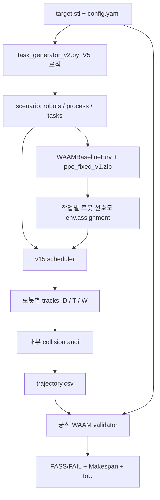

# WAAM 알고리즘 실행 구조

실제 검증 실행 코드를 기준으로 정리했습니다. 중심 흐름은 **STL → 적층 경로 생성 → PPO 로봇 선호도 → 안전 스케줄링 → CSV → 공식 validator**입니다.

## 1. 필수 입력과 주요 파일

아래 상대 경로는 `AI-Algorithm-team-3/validator/waam_sb3_baseline/`을 기준으로 합니다.

| 파일 | 역할 | 입력 → 출력 |
| --- | --- | --- |
| `target.stl` | 적층할 목표 형상 | 3D mesh |
| `config.yaml` | 층 높이, 비드 폭, 속도, 로봇 Base/Home/Reach, 충돌·형상 기준 | 모든 단계의 설정 |
| `generators/task_generator_v2.py` | STL 단면에서 적층 선분 생성 | STL+config → scenario의 tasks |
| `algorithm/environment/waam_env.py` | PPO에 상태를 제공하고 선택 결과를 로봇 배정으로 변환 | scenario+action → `env.assignment` |
| `outputs/ppo_fixed_v1.zip` | 저장된 PPO 모델 | observation → action |
| `schedulers/safe_scheduler_v15_adaptive_bundles.py` | v15 실행 진입점과 작업 묶음 스케줄링 | tasks+선호도+config → 로봇별 tracks |
| `schedulers/safe_scheduler_v12.py` | 연속 경로 연결, 선호 로봇 집계, 시작 시각 세부 탐색 | 선분 → chains, 안전 시작 시각 |
| `schedulers/safe_scheduler_v2.py` | 후보 경로의 시간 이동과 다른 로봇과의 충돌 검사 | candidate+기존 tracks → 충돌 여부·다음 시작 후보 |
| `training/export_and_check_v2.py` | `positions_at_times()`와 전체 시간 구간의 `audit()` 제공 | tracks → 샘플 충돌 수·최소 여유 |
| `validator/src/waam_validator/` | 공식 검증기 패키지. 위 표의 상대 경로 기준에서 한 단계 위에 있음 | config+target+trajectory → PASS/FAIL, Makespan, IoU |

**Generator 버전 주의:** `generators/task_generator_v2.py`와 `generators/task_generator_v5_optimized.py`는 현재 텍스트 내용이 완전히 동일합니다. 스케줄러의 import 이름은 `task_generator_v2`이지만 실제 내용은 V5 optimized 로직입니다. 이번 v15·v16·v17 실행 모두 같은 generator와 `ppo_fixed_v1.zip`을 사용했습니다.

스케줄러의 `from task_generator_v2 import build_scenario`는 실행 환경의 모듈 검색 경로를 통해 `generators/task_generator_v2.py`로 연결됩니다. 실제 검증용 실행 스크립트가 baseline, schedulers, generators, training 및 validator/src를 `PYTHONPATH`에 넣습니다.

`algorithm/preprocessing/task_generator.py`도 helper 파일들의 import 때문에 필요하지만, 위 v15 실행의 실제 scenario 생성 호출은 `generators/task_generator_v2.py`입니다. 파일 이름이 비슷한 다른 generator를 실행 경로와 혼동하지 않아야 합니다.

## 2. 전체 흐름

## 3. Task generator: 어디에 적층할지 결정

`build_scenario()`가 `generate_tasks()`를 호출합니다.

1. STL을 읽고 `layer_height_mm`와 `tcp_z_reference`에 맞는 높이에서 단면을 구합니다.
2. 단면을 구멍을 포함한 2D polygon으로 변환합니다.
3. `choose_edges()`가 Hatch 간격·안쪽 여유와 Skeleton 해상도를 바꾼 후보들을 평가합니다.
4. 비드 폭으로 경로를 buffer하여 Coverage, Overfill, IoU를 계산합니다.
5. config의 형상 조건을 만족하는 후보 중 경로 길이, 선분 수, IoU 부족량을 고려한 비용이 작은 후보를 고릅니다.
6. 선택된 경로를 `task_id`, `layer`, `start_xyz_mm`, `end_xyz_mm`으로 구성한 적층 task 목록으로 만듭니다.

반복되는 단면은 `(polygon WKB, 층 번호의 홀짝)`을 키로 경로를 재사용합니다. 단면이 계속 변하면 이 캐시의 효과가 작습니다. `scenario`는 실행 중 Python dict이며 별도의 scenario.json 파일을 만들 필요는 없습니다.

형상 조건을 만족하는 후보가 없으면 해당 층에서 오류로 중단합니다. 이 단계는 로봇의 최종 배치와 충돌 회피 대기 시각을 정하지 않습니다.

## 4. PPO와 환경: 로봇 선호도 생성

스케줄러는 `PPO.load(model_path)`로 기존 zip을 읽고 `model.predict(obs, deterministic=True)`를 반복합니다.

현재 환경은 25차원 observation을 사용하며 로봇 위치·누적 시간과 현재 task 정보 등을 제공합니다. 각 task를 각 로봇이 맡았을 때의 예상 완료시간을 계산해 로봇을 정렬합니다.

**Action 0/1/2는 로봇 ID 1/2/3이 아니라, 예상 완료시간 순위의 첫째/둘째/셋째 선택입니다.** 환경이 이를 실제 로봇 ID로 바꿔 `env.assignment[task_id]`에 저장합니다.

학습 보상은 Makespan 증가, 시간 불균형, 선택한 로봇의 부하를 벌점으로 반영합니다. 학습할 때는 이 보상으로 모델을 갱신하지만, 이번 검증에서는 기존 모델을 추론에만 사용했습니다.

PPO의 배정은 scheduler의 선호도입니다. Scheduler는 도달 범위, 충돌, 완료시간에 따라 다른 로봇을 선택할 수 있습니다.

## 5. v15 scheduler: 누가 언제 작업할지 결정

`schedule_bundles()`의 주요 처리입니다.

1. `chain_tasks()`가 이어지는 선분들을 연속 경로인 chain으로 연결합니다.
2. `build_same_layer_bundles()`가 같은 층의 가까운 chain을 묶습니다. 직접 이동이 HOME을 거치는 것보다 유리하고 두 chain을 담당 가능한 로봇이 있을 때 연결합니다.
3. 적층 시간이 긴 묶음부터 배치합니다.
4. 각 로봇에 대해 **HOME → 적층 경로 → 다음 경로로 Travel → … → HOME** 후보를 구성합니다.
5. XY Reach를 확인하고, 다른 로봇의 기존 작업 및 HOME 대기 상태와 충돌하는지 검사합니다.
6. 충돌하면 시작 시각을 뒤로 옮깁니다. v12 helper가 더 이른 안전 시각을 찾아 세부 조정하고 0.05초 여유를 더합니다.
7. 실행 가능한 후보 중 완료시각이 빠른 후보를 선택합니다. PPO 선호도는 같은 완료시각에서의 우선 선택에 영향을 줍니다.
8. 묶음 전체를 배치할 수 없으면 chain 개수 또는 chain의 edge 목록을 이분할하여 재시도합니다.
9. 실제 적층에 사용된 로봇 수가 기하학적으로 참여 가능한 로봇 수보다 적으면, `adaptive_reach_bundles()`로 담당 가능한 로봇 집합의 경계에 따라 다시 묶고 재스케줄합니다.

v15의 adaptive 비교에서는 더 많은 로봇을 활성화하는 스케줄을 우선합니다. 활성 로봇 수가 같으면 Makespan이 작은 스케줄을 고릅니다. 따라서 v15의 adaptive 선택 기준을 단순히 “항상 최소 Makespan만 선택”이라고 설명하면 부정확합니다.

Tracks에는 `(시작 시각, 끝 시각, 시작 좌표, 끝 좌표, mode)` 구간이 저장됩니다. `D`는 적층, `T`는 이동, `W`는 대기입니다. Makespan은 모든 로봇의 작업 종료시각 중 최댓값입니다.

## 6. 내부 audit와 공식 validator

`export_and_check_v2.audit()`는 설정된 시간 간격으로 전체 tracks를 샘플링하여 Arm Envelope와 TCP 반경 충돌을 점검합니다. `safe_scheduler_v2.candidate_conflict()`는 후보 배치 중 시간·이동 거리 기준과 구간 경계도 포함해 검사합니다.

CSV는 v15의 `write_validator_csv()`로 저장합니다. `export_and_check_v2.py` 안의 별도 진단용 exporter를 v15의 최종 CSV exporter와 혼동하지 않아야 합니다.

공식 validator는 `config.yaml`, `target.stl`, `trajectory.csv`를 읽고 도달 범위·충돌·형상을 최종 판정합니다. 내부 audit 통과만으로 공식 PASS가 확정되지는 않습니다.

## 7. v15 / v16 / v17 차이

| 버전 | 추가 기능 |
| --- | --- |
| v15 | 같은 층의 chain 묶음, 충돌 회피, fallback 분할, 로봇 활용 부족 시 adaptive 재묶음 |
| v16 | v15 기준 스케줄을 보존하고 묶음 처리 순서를 바꾸는 탐색. 더 빠르고 내부 충돌 검사를 통과한 후보만 채택 |
| v17 | v16 흐름에서, 긴 chain의 edge들을 따라가며 공통 담당 로봇 집합이 비기 전에 먼저 분할. 선택적 adaptive 묶음 오류에도 기준 스케줄 보존 |

v17의 분할은 좌표·edge 방향·원래 chain 내부의 순서를 보존합니다. 기존 chain 전체가 한 로봇의 Reach 안에 있으면 추가 분할하지 않습니다. 현재 01·03·06은 추가 분할이 없었고, 02는 탐색 chain이 8개에서 24개로 늘었습니다. 새 후보가 기준보다 느리면 최종 CSV는 기준 스케줄을 사용합니다.

## 8. 무엇을 수정할지

| 목적 | 중심 파일/단계 |
| --- | --- |
| Coverage·IoU·Overfill 개선 | task generator의 경로 후보, 비드 폭 기준, 형상 평가 |
| Makespan 개선 | scheduler의 분할 위치, 묶음 구성, 로봇 배치, 처리 순서, 이동·대기 |
| 로봇 선호도 학습 변경 | `algorithm/environment/waam_env.py`와 학습 스크립트 |
| 최종 판정 기준 확인 | 공식 validator의 config 및 검증 코드 |

`training/train.py`는 새 PPO 모델을 학습할 때 사용하는 스크립트입니다. 기존 모델로 검증할 때 이를 실행할 필요는 없습니다. 현재 학습 스크립트는 `algorithm.preprocessing.task_generator`를 import하므로, 재학습할 때는 실제 학습 generator와 추론 generator의 연결도 확인해야 합니다. 파일만으로 기존 `ppo_fixed_v1.zip`의 과거 학습 과정 전체를 확정할 수는 없습니다.

핵심 역할 분담: **generator는 적층 형상, PPO는 로봇 선호도, scheduler는 안전한 작업 일정, validator는 최종 판정**입니다. 경로 길이도 적층 시간을 바꾸므로 generator가 Makespan에 영향을 줄 수 있고, edge를 바꾸지 않는 scheduler 수정은 일반적으로 형상 지표를 유지합니다.
